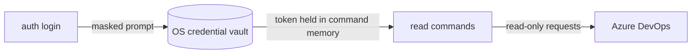

# Getting started

This repository ships six read-only .NET tools that retrieve Azure DevOps work-item, pull-request, pipeline, Wiki, and sprint context as stable JSON for humans and AI agents, and three write tools that open pull requests, post comments, resolve threads, requeue pull-request builds and vote on your behalf. The read tools never edit Azure DevOps, vote, reply to reviews, or store credentials. They never retrieve arbitrary repository content: only one selected Wiki-backed Markdown file may be read through the exact Wiki Git-path handoff. The write tools open pull requests, add comments (a work-item discussion comment, a pull-request thread, general or attached to lines, or a reply in a pull-request thread, optionally with uploaded files), resolve and reopen pull-request threads, requeue a pull request's build policies, and set your vote on a pull request. Files attached to a work-item comment are also added to the work item's Attachments; apart from that, the write tools never edit or delete comments, complete pull requests, or change any other field (see [Writing comments](writing.md#writing-comments), [Creating pull requests](writing.md#creating-pull-requests), [Resolving and reopening threads](writing.md#resolving-and-reopening-threads) and [Requeueing builds and voting](writing.md#requeueing-builds-and-voting)).

## Tools

`ado-read` is the umbrella tool and contains every feature. Five slice tools each contain one feature, so an agent or a team can install only what it needs. Every tool shares the same JSON contract, `config`, `auth`, `privacy`, and the same `project list` and `team list` discovery commands.

Every tool's package ID is also its command, so `dotnet tool install --global ado-read-pr` installs `ado-read-pr`, and `dnx ado-read-pr show 412` runs it without installing. Commands follow one pattern, `<resource> [<child>] <verb> [<id-or-url>]`: singular nouns (`pr`, `work-item`, `wiki`, `sprint`, `pipeline`, `project`, `team`), and the verbs `show` (one item), `list` (many) and `search` (by text).

| Package ID and command | Commands |
| --- | --- |
| `ado-read` | `config`, `auth`, `privacy`, `project list`, `team list`, `pr show <id-or-url>`, `pr list`, `work-item show <id-or-url>`, `work-item list`, `wiki list`, `wiki page list\|show\|search`, `sprint list\|show`, `pipeline run list --pr <id-or-url>`, `pipeline run show <id-or-url>`, `pipeline test list --run <id-or-url>` |
| `ado-read-pr` | `show <id-or-url>`, `list [filters]`, `config`, `auth`, `privacy`, `project list`, `team list` |
| `ado-read-work-item` | `show <id-or-url> [--download-images]`, `list [filters \| --wiql]`, `config`, `auth`, `privacy`, `project list`, `team list` |
| `ado-read-wiki` | `list`, `page list\|show\|search`, `config`, `auth`, `privacy`, `project list`, `team list` |
| `ado-read-sprint` | `list`, `show`, `config`, `auth`, `privacy`, `project list`, `team list` |
| `ado-read-pipeline` | `run list --pr <id-or-url>`, `run show <id-or-url>`, `test list --run <id-or-url>`, `config`, `auth`, `privacy`, `project list`, `team list` |

The write tools are separate packages, so installing a read tool never gives an agent the ability to post. They share `config`, `auth` and the token with the read tools; they have no `privacy`, `project list` or `team list` commands because they return no Azure DevOps content. Every write waits until you approve it in its own approval window (`approval open <id>`); see [Approving writes](writing.md#approving-writes).

| Package ID and command | Commands |
| --- | --- |
| `ado-write` | `config`, `auth`, `approval open <id>`, `pr create\|comment\|reply\|resolve\|unresolve\|requeue\|vote`, `work-item comment` |
| `ado-write-pr` | `create`, `comment <id-or-url>`, `reply <id-or-url>`, `resolve <id-or-url>`, `unresolve <id-or-url>`, `requeue <id-or-url>`, `vote <id-or-url>`, `approval open <id>`, `config`, `auth` |
| `ado-write-work-item` | `comment <id-or-url>`, `approval open <id>`, `config`, `auth` |

In a slice tool the feature name moves into the executable, so `ado-read-wiki page show <url>`, `ado-read-sprint show` and `ado-read-pipeline run list --pr <url>` are the paths there. Commands of another feature are rejected with `invalidArguments`. All examples below use the umbrella `ado-read` paths.

## Requirements

- .NET SDK or runtime 10.0.
- An Azure DevOps personal access token, stored by `auth login` in your operating system's credential vault (see below). Use only the minimum **Work Items (Read)**, **Code (Read)**, **Wiki (Read)**, **Build (Read)**, **Test Management (Read)**, and **Project and Team (Read)** scopes required for the commands you use. Wiki discovery, page lookup, and search need **Wiki (Read)**. **Code (Read)** is needed for pull-request lookups, and additionally for `wiki page show` when it follows a selected search hit to its exact Wiki-backed Git path. The pipeline commands need **Build (Read)**, **Test Management (Read)**, and **Code (Read)**. The sprint commands read iterations and team settings, which the **Work Items (Read)** scope covers.
- For the write tools, the same token also needs **Work Items (Read & write)** for work-item comments, **Code (Read & write)** for pull-request comments, build requeues and votes, and **Identity (Read)** when a comment mentions people by mail address. Every read and write tool uses one token per organization, so log in once with any of them.
- One configured Azure DevOps Services organization at `https://dev.azure.com/{organization}`. Azure DevOps Server is not supported.

## Install

Build the local packages from this repository. Each tool project packs into `artifacts/packages`:

```powershell
dotnet restore AdoRead.slnx --locked-mode
dotnet build AdoRead.slnx --no-restore --configuration Release
dotnet pack src/AdoRead.Cli/AdoRead.Cli.csproj --no-build --configuration Release
dotnet pack src/AdoRead.PullRequests.Cli/AdoRead.PullRequests.Cli.csproj --no-build --configuration Release
dotnet pack src/AdoRead.WorkItems.Cli/AdoRead.WorkItems.Cli.csproj --no-build --configuration Release
dotnet pack src/AdoRead.Wiki.Cli/AdoRead.Wiki.Cli.csproj --no-build --configuration Release
dotnet pack src/AdoRead.Sprints.Cli/AdoRead.Sprints.Cli.csproj --no-build --configuration Release
dotnet pack src/AdoRead.Pipelines.Cli/AdoRead.Pipelines.Cli.csproj --no-build --configuration Release
dotnet pack src/AdoWrite.Cli/AdoWrite.Cli.csproj --no-build --configuration Release
dotnet pack src/AdoWrite.PullRequests.Cli/AdoWrite.PullRequests.Cli.csproj --no-build --configuration Release
dotnet pack src/AdoWrite.WorkItems.Cli/AdoWrite.WorkItems.Cli.csproj --no-build --configuration Release
```

Install one package into an isolated local tool path. Replace the name for another tool from the table above:

```powershell
dotnet tool install --tool-path .\.tools\ado-read --add-source .\artifacts\packages ado-read --version 1.0.0
.\.tools\ado-read\ado-read --help
```

From a configured NuGet feed, install the umbrella or any slice globally with its package ID:

```powershell
dotnet tool install --global ado-read
dotnet tool install --global ado-read-pr
dotnet tool install --global ado-read-work-item
dotnet tool install --global ado-read-wiki
dotnet tool install --global ado-read-sprint
dotnet tool install --global ado-read-pipeline
dotnet tool install --global ado-write
dotnet tool install --global ado-write-pr
dotnet tool install --global ado-write-work-item
```

Updating or uninstalling a tool remains local to the caller, for example:

```powershell
dotnet tool update --global ado-read-pr
dotnet tool uninstall --global ado-read-pr
```

Previews before this naming used the package IDs `AdoRead.Tool`, `AdoRead.PullRequests.Tool`, `AdoRead.WorkItems.Tool`, `AdoRead.Wiki.Tool`, `AdoRead.Sprints.Tool`, `AdoRead.Pipelines.Tool`, `AdoWrite.Tool`, `AdoWrite.PullRequests.Tool` and `AdoWrite.WorkItems.Tool`. Uninstall those first: seven of the nine commands kept their name, and .NET refuses a second package with the same command.

```powershell
dotnet tool uninstall --global AdoRead.Tool
dotnet tool install --global ado-read
```

## Configure authentication and the organization

The token lives only in your operating system's credential vault, and only `auth login` writes it there. The tool never accepts a token as a command-line argument, never reads one from an environment variable or a file, and never writes one to a config file, log, or command output. Keep tokens out of source control and fixtures.

The command examples below assume a global installation or that the tool directory is on `PATH`. For the isolated installation above, replace `ado-read` with `.\.tools\ado-read\ado-read`.

```powershell
ado-read config init --organization https://dev.azure.com/example
ado-read auth login
ado-read auth status
ado-read config show
```



Legend: `auth login` is the only writer of the token. Read commands fetch it from the vault for their configured organization and send it only to that Azure DevOps organization.

By default, the non-secret configuration is stored at `~/.ado-read/config.json`. Pass `--config <path>` to any command to use another file, for example in CI or a test. `config init` does not overwrite an existing file unless `--force` is supplied.

The configuration holds the organization URL, a whole-command timeout (1–300 seconds), and the bounded project-search concurrency (1–16). It never contains a token.

### Sign in per organization

Create the token in Azure DevOps with only the scopes listed under Requirements. Then run `auth login` in an interactive terminal. It prompts `Personal access token for <organization>:` on stderr, masks the input, and stores the token for the configured organization. Pass `--organization <url>` to store a token for another organization. Every tool has the same commands; in the umbrella tool they are `ado-read auth …`, and in a slice tool they sit on the executable, for example `ado-read-wiki auth login`.

| Command | What it does |
| --- | --- |
| `auth login [--config <path>] [--organization <url>]` | Asks Azure DevOps whose the typed token is, then stores it for every tool. A token Azure DevOps rejects, or cannot check because it cannot be reached, is not stored: the command fails with the error's code, such as `unauthorized` or `networkError` (exit 5), and keeps any token already stored. In a read tool, if the organization has no privacy policy, asks for one (see [Privacy](privacy.md)). Fails with `interactiveTerminalRequired` (exit 2) when input is redirected, and with `tokenRequired` (exit 2) when the token is blank. The output names the vault, confirms storage, has `actingAs` with the display name of the token's owner, and has `replacedStoredToken: true` when it replaced a different stored token, which every tool then stops using; it never includes the token. |
| `auth status [--config <path>] [--organization <url>]` | Reports whether a token is stored for the organization, which vault holds it, and in `actingAs` whose it is. A stored token Azure DevOps rejects, for example because it expired, fails with `unauthorized` (exit 5) and a message naming the `auth login` command that replaces it. It never shows any part of the token. |
| `auth logout [--config <path>] [--organization <url>]` | Removes the stored token and reports whether one was removed. |

A read command with no stored token fails with `missingPat` (exit 5) and names the login command to run.

When Azure DevOps refuses the token (`unauthorized` or `forbidden`, exit 5), the error names the scopes that command needs and the login command that replaces the token. Azure DevOps does not say which scope is missing, so the message lists all the scopes the command uses. A token refused as soon as a command connects, for example because it expired, fails with `unauthorized` in the `authentication` scope, and its message names only the login command, because no scope helps there.

All nine tools share one token per organization and the same configuration file, so `auth login` in any of them signs in all of them, and `auth logout` in any of them signs them all out. `ado-write auth login` (or `ado-write-pr auth login`, `ado-write-work-item auth login`) asks for no privacy level, because the write tools return no Azure DevOps content; until a person runs `privacy set`, read commands fail with `privacyPolicyRequired`.

Earlier prereleases kept the write tools' token separately, under `<organization>#write`. `auth login` and `auth logout` remove that entry when they find it and report `legacyWriteTokenRemoved: true`. After upgrading, run `auth login` once with a token that has both the read and the write scopes you use.

### Credential vaults

| Operating system | Vault | Notes |
| --- | --- | --- |
| Windows | Windows Credential Manager | Stored for the current user on this machine. Not roaming with the domain profile. |
| macOS | Keychain | The current user's login keychain. |
| Linux | Secret Service through libsecret | Needs `libsecret` and a running Secret Service provider in your desktop session, such as gnome-keyring. |

There is no plaintext or file fallback. When no vault is available, for example on Linux without a Secret Service, every command that needs a token fails with `credentialStoreUnavailable` (exit 5). Commands that do not need a token, such as `--help` and `config show`, keep working.

## Commands

```text
ado-read config init --organization https://dev.azure.com/example [--project <name>] [--team <name>] [--config <path>] [--force]
ado-read config show [--config <path>]
ado-read privacy show [--organization <url>] [--config <path>] [--compact]
ado-read privacy set <minimal|standard|full> [--allow <category>]... [--deny <category>]... [--organization <url>] [--config <path>] [--compact]
ado-read privacy reset [--organization <url>] [--config <path>] [--compact]
ado-read work-item show <id-or-url> [--download-images <empty-directory>] [--config <path>] [--compact]
ado-read work-item list [--project <name>] [--tag <tag>]... [--assignee me|none|<name>] [--state <state>]... [--area <path>]... [--type <type>]... [--top <1..200>] [--full] [--config <path>] [--compact]
ado-read work-item list --wiql <query> [--top <1..200>] [--full] [--config <path>] [--compact]
ado-read pr show <id-or-url> [--config <path>] [--compact]
ado-read pr list [--author me|<name>] [--reviewer me|<name> [--vote <vote>]] [--status active|completed|abandoned|all] [--repository <name-or-id>] [--project <name-or-id>] [--top <1..200>] [--full | --activity] [--config <path>] [--compact]
ado-read pipeline run list --pr <id-or-url> [--project <name-or-id>] [--repository <name>] [--log-lines <1..500>] [--config <path>] [--compact]
ado-read pipeline run show <id-or-url> [--project <name-or-id>] [--log-lines <1..500>] [--config <path>] [--compact]
ado-read pipeline test list --run <id-or-url> [--project <name-or-id>] [--outcome failed|all] [--top <1..1000>] [--config <path>] [--compact]
ado-read project list [--config <path>] [--compact]
ado-read team list [--project <name>] [--all] [--config <path>] [--compact]
ado-read sprint list [--project <name>] [--team <name>] [--timeframe current|past|future] [--config <path>] [--compact]
ado-read sprint show [--project <name>] [--team <name>] [--sprint <name-or-path>] [--state <state>...] [--config <path>] [--compact]
ado-read wiki list [--project <name-or-id>] [--config <path>] [--compact]
ado-read wiki page list [--project <name-or-id>] --wiki <id-or-name> [--version <value>] [--version-type branch|tag|commit] [--top <1..100>] [--continuation-token <opaque>] [--config <path>] [--compact]
ado-read wiki page show [<ado-wiki-url>] [--project <name-or-id>] [--wiki <id-or-name>] [--path </display/page> | --page-id <positive-int> | --git-path </repo/page.md>] [--version <value>] [--version-type branch|tag|commit] [--config <path>] [--compact]
ado-read wiki page search <text> [--project <name-or-id> | --all-projects] [--skip <non-negative-int>] [--top <1..25>] [--config <path>] [--compact]
```

`--compact` removes JSON indentation only. `--help` and `--version` use conventional human-readable command output; every expected command outcome is exactly one JSON document on standard output.

Each resource has its own page with examples and output details: [pull requests](pull-requests.md), [work items](work-items.md), [pipelines](pipelines.md), [sprints](sprints.md), [Wiki](wiki.md), and the [write tools](writing.md). [Privacy](privacy.md) covers privacy levels, [JSON contract and exit codes](json-contract.md) covers output, and [Agent integration](agent-integration.md) covers use from an agent.
