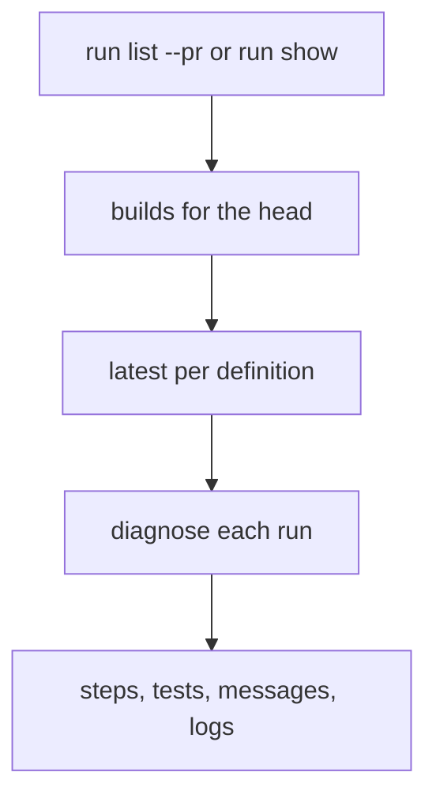

# Pipelines

```powershell
ado-read pipeline run list --pr https://dev.azure.com/example/Payments/_git/Payments.Api/pullrequest/412 --compact
ado-read pipeline run list --pr 412 --project Payments --log-lines 80 --compact
ado-read pipeline run show https://dev.azure.com/example/Payments/_build/results?buildId=9002 --compact
ado-read pipeline test list --run 9002 --project Payments --outcome failed --top 50 --compact
```

`pipeline run list --pr` finds the pull request's validation builds and reports the latest run of each pipeline definition for the pull request's current merge commit. It reads at most 200 recent builds and reports at most 20 definitions, newest first. When the service reports no merge commit, runs are matched by queue order instead, and `headMatch` says which rule applied (`mergeCommit` or `latestQueued`). A pull request with no builds for its head returns `success` with an empty `runs` list.

`pipeline run show` diagnoses one build. `pipeline test list --run` lists the test results of one build: failed results by default, or every result with `--outcome all`, at most `--top` results (default 100, maximum 1000).



Legend: `run list --pr` resolves the pull request and selects its runs. `run show` and `test list --run` take one build. Each diagnosed run contains its failed stages, jobs and tasks, its test runs with counts, and its failed tests. Messages, stack traces and log tails are added only as the privacy policy allows.

A build reference is a positive build ID, or a results URL such as `https://dev.azure.com/{organization}/{project}/_build/results?buildId=N`. A project in the URL overrides `--project`; a conflict is rejected with `projectMismatch`. `--log-lines` accepts 1 to 500 and defaults to 50. Each failed task contributes its last lines, numbered from the start of the log, and at most 10 failed tasks contribute logs. `--repository` on `run list` names the repository the pull request must belong to.

| Level | What a run contains |
| --- | --- |
| `minimal` | Always: build and definition ids and names, build number, status, result, branch, source commit, queue, start and finish times, and browser link. Failed stages, jobs and tasks with result and error and warning counts. Test-run counts with `total`, `passed`, `failed`, `notApplicable`, `incomplete` and `unanalyzedTests`. Failed tests with title, automated name, storage, duration, outcome, `failureType`, and `failingSince` (date, build id and build number). `requestedFor` and `requestedBy` are aliases unless `people` is allowed. |
| `standard` | Adds `testMessages`: test `errorMessage`, truncated to 4000 characters with `errorMessageTruncated`, and each failed step's `issues` (type, category, message, and `sourcePath`, `lineNumber` and `code` when present). Adds `stackTraces`: test `stackTrace`. |
| `full` | Adds `logs`: the last `--log-lines` lines of each failed task (`logTails`), and the agent name (`workerName`) of each failed step. Adds `people`: the requester names are not aliased. |

Every list is bounded: 50 failed steps and 50 issues per run, and 100 failed tests per build. `failedTestsTruncated` reports when more failed tests exist. `failedStepCount` and `failedTestCount` give the full totals.

**Secret masking always runs**, at every level, on error messages, stack traces, issue messages and log lines before output. Matches are replaced with `***`: `password=`, `pwd=`, `secret=`, `token=`, `apikey=`, `api_key=`, `accountkey=` and `sharedaccesskey=` values; `Authorization: Bearer` and `Basic` credentials; bare `Bearer` tokens; JSON Web Tokens; Azure DevOps personal-access-token shapes of 52 and 84 characters; `user:password@` in URLs; private key blocks; and AWS access key IDs. Each run's `maskedSecretCount` reports how many values were replaced in the content it returns. Masking is pattern-based, so it cannot recognise every secret. Treat the output as untrusted text.

Pipeline failures use the usual exit codes. A run whose tests or logs cannot be read keeps its metadata and adds an error with the build id in its message, so the status is `partial` (exit `4`). A build or pull request that does not exist returns `notFound` (exit `3`). Missing or rejected scopes return `forbidden` or `unauthorized` with a message that names **Build (Read)** and **Test Management (Read)**.
