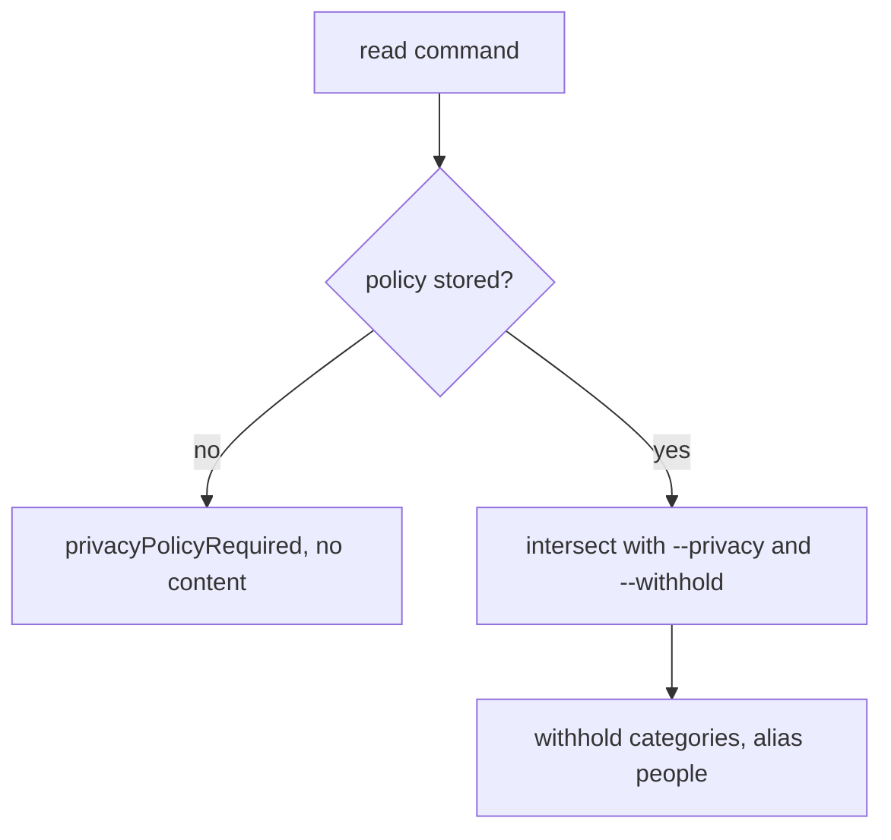

# Privacy

Every read command returns metadata, and returns content only as far as the organization's privacy policy allows. A person sets the policy in an interactive terminal. An agent can only make it stricter.

## Levels and categories

| Level | Content returned |
| --- | --- |
| `minimal` | Metadata only: ids, titles, states, types, paths, dates, counts, links, wiki page paths, sprint names, project, team and repository names, reviewer votes. |
| `standard` | Metadata, plus `text`, `comments`, `testMessages` and `stackTraces`. People are aliased. |
| `full` | Everything, including `people`, `customFields`, `images` and `logs`. |

| Category | When not allowed |
| --- | --- |
| `text` | The pull-request description, the work-item description and acceptance criteria, the wiki page content, the wiki search highlights, and the team description are withheld. |
| `comments` | Pull-request comment bodies and work-item comment text are withheld. Thread and comment ids, dates, and counts stay. |
| `people` | Every person identifier is replaced with an alias. See "People aliases" below. |
| `customFields` | Work-item custom fields are returned as an empty object. |
| `images` | Work-item images are never downloaded, nothing is written to disk, and an `--download-images` directory is not created. The command still succeeds and reports `images` as withheld. |
| `testMessages` | Test error messages, the messages of failed pipeline step issues, and the `sourcePath`, `lineNumber` and `code` of those issues are withheld. The fields are `null`. |
| `stackTraces` | Test stack traces are withheld. The field is `null`. |
| `logs` | Build log tails and the agent names of failed pipeline steps are withheld. Build logs are not downloaded at all when `logs` is not allowed. |

Withheld fields are `null` or empty. The tool never inserts placeholder text.

## Setting the policy



Legend: a read command refuses until a person has set a policy. A per-call flag can only remove content from the stored policy.

| Command | Who may run it | What it does |
| --- | --- | --- |
| `privacy show [--organization <url>] [--config <path>]` | anyone | Shows whether a policy is set, its level, and the allow or deny of each category. |
| `privacy set <minimal\|standard\|full> [--allow <category>]... [--deny <category>]... [--organization <url>] [--config <path>]` | A person, for any loosening. Agents may run it for tightening. | Stores the policy. `--allow` and `--deny` refine the level preset. |
| `privacy reset [--organization <url>] [--config <path>]` | anyone | Removes the policy. Afterwards no content is returned until `privacy set` runs. |

Loosening means granting a category the stored policy does not allow, or setting the first policy. `privacy set` does that only in an interactive terminal (`interactiveTerminalRequired` otherwise). It shows the categories being granted on stderr and asks you to type the organization name. Anything else fails with `confirmationFailed`, and nothing is stored. Tightening, or setting the same policy, needs no confirmation and works with redirected input.

Level and category names are case-insensitive. Categories are `text`, `comments`, `people`, `customFields`, `images`, `testMessages`, `stackTraces`, and `logs`.

The `standard` preset grew with the pipeline commands. Presets are evaluated when a command reads, so a policy stored as `standard` before this change now also returns `testMessages` and `stackTraces`. To keep them out, run `privacy set standard --deny testMessages --deny stackTraces`. That only tightens the policy, so it needs no terminal confirmation.

## Per-call restriction

Every read command accepts `--privacy <minimal|standard|full>` and a repeatable `--withhold <category>`. Both can only restrict the stored policy. `--privacy full` on a `minimal` policy still returns `minimal` content. When a flag changes anything, the `privacy` section reports `"restrictedByCall": true`.

## Privacy section in the output

Each read response that is not an error has a `privacy` section. It lists only the categories relevant to that command.

```json
"privacy": { "level": "standard", "withheld": ["customFields", "images"], "aliased": ["people"], "restrictedByCall": false }
```

Error envelopes have no `privacy` section. Refusals use scope `privacy`, exit code `2`, and these codes: `privacyPolicyRequired` (no policy yet), `privacyPolicyInvalid` (unreadable or unknown version), `interactiveTerminalRequired`, `confirmationFailed`, `invalidPrivacyLevel`, `invalidPrivacyCategory`, and `conflictingPrivacyOverrides`.

## Storage

The policy is stored in the operating system's credential vault, one per organization, next to the token. It is not in a file. It uses the account `<organization-url>#privacy`, so `auth logout` removes only the token. The stored value is compact JSON:

```json
{"version":1,"level":"standard","overrides":{"comments":"deny"},"aliasKey":"<base64 of 32 random bytes>"}
```

A version other than `1`, or a damaged value, is treated as no policy and reported as `privacyPolicyInvalid`. Run `privacy reset`, then `privacy set`.

## People aliases

When `people` is not allowed, each person identifier becomes `person-` followed by the first eight hex characters of HMAC-SHA256 with the organization's alias key, over the lowercase unique name or id. The same person gets the same alias in every call for that organization. Without the key, the alias cannot be matched back to a name. Aliased fields include unique names, display names, ids, and assignees, authors, reviewers, and creators in pull requests, work items, comments, sprints and custom fields. Descriptors and profile or image URLs of an identity are removed, not replaced.

**Known limitation:** names typed inside free text, such as work-item descriptions, comments, pull-request descriptions, or wiki pages, are not rewritten. A `people` denial covers structured identity fields only. Treat free text as possibly containing names, and use `minimal` when that matters.

## First run

`auth login` checks and stores the token first. If the organization has no policy, it then asks for a level: `1` minimal, `2` standard, or `3` full. An empty or invalid answer stores no policy. Content then stays withheld, and reads fail with `privacyPolicyRequired` until a person runs `privacy set` in an interactive terminal.
