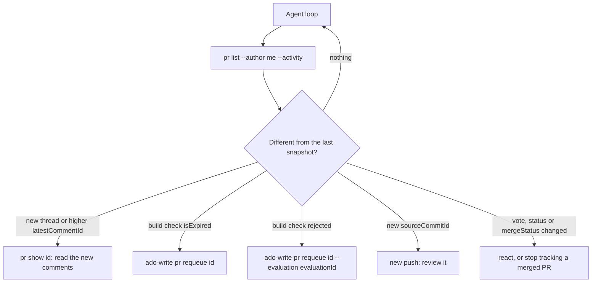

# Pull requests

```powershell
ado-read pr show 412 --compact
ado-read pr show https://dev.azure.com/example/Payments/_git/Payments.Api/pullrequest/412 --compact
```

The input can be a positive ID, a pull-request browser URL, or a pull-request REST URL. Canonical `dev.azure.com` and legacy `*.visualstudio.com` HTTPS URLs are accepted. The tool extracts the ID and verifies that the URL organization matches configuration. You never name the project.

Lookup is two stage. Pull-request IDs are unique within an organization, so the tool first asks Azure DevOps for the ID at organization scope; that single call resolves the owning project and answers the common case. If that lookup cannot answer — no such pull request, or the call is unavailable to the caller — the tool falls back to discovering every accessible project and searching them with bounded concurrency, returning every matching PR in deterministic project/repository order. The fallback is the authoritative path, so a `partial` result can still occur when some projects fail.

PR results use the lean `pullRequestSearch` v2 contract: title, status, author/reviewer unique names and votes, source/target revisions, linked work-item references, and review threads with comments. A thread can include `reviewedCommitId`, `latestCommitId`, and `isPossiblyOutdated`; each is nullable when Azure DevOps does not supply usable iteration provenance. `isPossiblyOutdated` describes only whether a file location may be stale, not whether the review feedback is relevant. PR results do not include commits, iterations, or changed-file metadata. Use the source and target commit IDs plus the thread's file path and line range to inspect the change with local Git; the `pr` command never retrieves repository file contents.

## Listing pull requests

```powershell
ado-read pr list --author me --compact
ado-read pr list --reviewer me --vote none --compact
ado-read pr list --repository Payments.Api --status completed --top 20 --compact
ado-read pr list --reviewer me --vote wait-for-author --full --compact
ado-read pr list --author me --activity --compact
```

`pr list` returns pull requests newest first, from every accessible project or from `--project`. `--status` is `active` (default), `completed`, `abandoned` or `all`. `--author` and `--reviewer` take `me` for the token's owner, or a person's unique name (e-mail) or display name. `--vote` needs `--reviewer` and keeps the pull requests where that reviewer's vote is `approve`, `approve-with-suggestions`, `none`, `wait-for-author` or `reject`, the same values `ado-write pr vote` takes. So `--reviewer me --vote none` lists what you still have to review. `--repository` takes a repository name or ID.

Azure DevOps filters the status, and `--author me` and `--reviewer me`, itself. Names, the repository and the vote are checked by the tool on each page of results. Each project is read 100 pull requests at a time until it has `--top` matches, and at most 1,000 deep. A project that hits that limit before it has enough matches makes the result `partial` (exit `4`) with a `scanLimitReached` error naming the project, even when nothing matched yet. A reviewer filter matches the people asked directly, not a group or team the person belongs to. An empty filter value is refused with `emptyFilter`. A project that can't be read makes it `partial` with that project's error.

By default the result has kind `pullRequestList` (schema `1.0`), with one short entry per pull request: `id`, `title`, `status`, `mergeStatus`, `isDraft`, `createdAtUtc`, `creatorUniqueName`, `project`, `repository`, `sourceRefName`, `targetRefName`, `reviewers` (unique name, vote, review status, required) and `browser`. With `--full`, the result has kind `pullRequestSearch` (schema `2.0`) with the `pr show` document of each match, threads and work items included, each read on its own like `pr show` (a listed page shortens descriptions), up to `maxParallelProjects` at a time. `--top` (default 50, at most 200) limits what is returned. When people are withheld, a named `query.author` or `query.reviewer` is replaced by an alias of the text you gave; it matches a person's alias in the results only when you gave their unique name.

## Watching pull requests for changes



`--activity` adds two lists to each short entry, so an agent that polls all day can see what changed without reading any comment text. Every entry also carries `mergeStatus` and `sourceCommitId`, the source commit Azure DevOps last merged, which changes with each push.

- `checks`: each applicable branch-policy evaluation, such as build validation or required reviewers, with `evaluationId`, `name`, `typeId`, `type`, `status` (`approved`, `rejected`, `running`, `queued`, `notApplicable` or `broken`), `isExpired`, `isBlocking` and `buildId`. A build check has `typeId` `0609b952-1397-4640-95ec-e00a01b2c241`. `ado-write pr requeue <id>` runs every expired build again; a build that failed (`rejected`, not expired) is run again only by naming it, `ado-write pr requeue <id> --evaluation <evaluationId>`.
- `threads`: each thread with comments from people (threads of only system comments, such as votes or pushes, are left out), with `id`, `status`, `commentCount`, `latestCommentId`, `lastUpdatedAtUtc` and `latestContentChangeAtUtc`. A thread `id` you haven't seen, or a higher `latestCommentId`, means a new comment; a later `latestContentChangeAtUtc` means an edited one. `lastUpdatedAtUtc` also moves when a comment is deleted or the status changes, so it says only that something happened in the thread. Read the comments with `pr show`.

Together with the reviewers' votes and `status`, that covers a new or edited comment, an expired or failed build, a push, an approval, and a merge or abandon. A snapshot covers only the pull requests the list returns: with `--status all` and the default `--top 50`, a pull request drops out once 50 newer ones exist, so keep `--top` above the number of pull requests being watched, or read a known one with `pr show`. `--activity` costs at least two more calls per pull request, read up to `maxParallelProjects` at a time. A pull request whose activity can't be read, or isn't read before the request timeout, keeps its row without `checks` and `threads`, and the result is `partial` with its error. `--activity` can't be combined with `--full`, which already returns every thread. Checks and thread counts hold no comment text or people, so every privacy level shows them; a policy's `name` is shown like other metadata, such as project and repository names. Reading checks is documented to need **Code (Read)**; this was not tried against a live organization.
